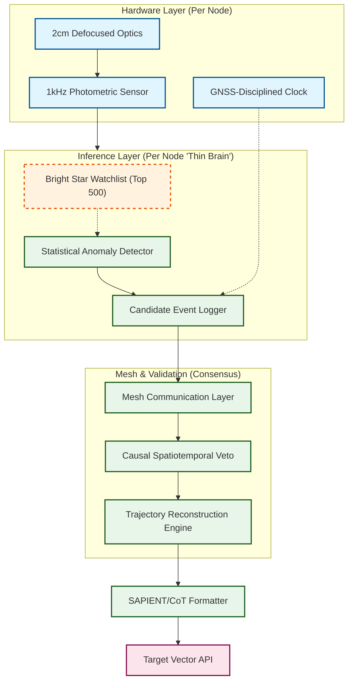

# dwallener.github.io
Repos: https://github.com/dwallener?tab=repositories

Basically, my thing is bridging the chasm between connectomes and network implementations we can build with "normal" math on "normal" hardware. I believe there is a way to leverage the locally-dense sparsity of neural spiking networks to create models that are much more efficient in energy usage and training. 

Parcellization of the human brain:

https://streamable.com/r2mo8v

Block by block mapping of the fly connectome to a parcellized fly "brain":

## Fun stuff:

- SNES Disassembler and ROM constructor: https://github.com/dwallener/snes-rom-hack/

This has been put to pasture...we're awfully close to frontier models being able to few-shot this now

- Ancient Text Translator: https://github.com/dwallener/MyTranslations

I am super particular about text translation. So particular I am dissatisfied by nearly all of them. Exceptions would be Everett Fox ("Five Books of Moses"), Wilson ("Odyssey"), Waterfield ("Meditations"). So I built my own system for creating the style I want to read - concise, no decorations, coneptually consistent with vocalizations. Currently I am working on a basic collection from Chinese antiquity, because this is a huge hole in the body of work.

## Geospatial x Mobility Analysis

Production system (in commercial deployment) for location x demographic message targeting. Also incorporates automatic generation of highly localized "newspapers" to understand what is important in any given community at the time. Combined, it allows for rapid theme discovery, message formulation, and delivery for commercial, civic and political entities.

Most of the work for optimizing LLM size using operator+state approach is in private repos, including the Anduril drone autonomy and DARPA liquidity/money-laundering monitoring applications. Feel free to reach out to discuss deeper work.

## Project ARGUS (Attritable Reconnaissance & Global Under-star Surveillance): 

Distributed Causal Inference for Cislunar Custody.

Repo (private): https://github.com/dwallener/argus

## Executive Summary

### The Mission
To eliminate the "Cislunar Gap" by deploying a high-density, low-cost Distributed Tripwire network. We provide persistent anomaly detection and track refinement in deep space and contested terrestrial borders where traditional IR and Radar are economically or physically blinded.

ARGUS does **not** require high per-node SNR. We utilize high-speed (1 kHz) photometry to extract sub-noise transients, validated via a causal spatiotemporal veto across a shared stellar coordinate system.

### The Problem: The "Exquisite" Failure
Current Space Situational Awareness (SSA) relies on "Exquisite" sensors—billion-dollar telescopes and high-power radars. These systems are:

- Targetable: High-signature active emitters are easily jammed or destroyed.
- Blind: Traditional optics are neutralized by the Moon’s glare or atmospheric noise.
- Sparse: They provide high fidelity on known objects but fail at "discovery" across the 1,700x volume increase of Cislunar space.

The Solution: The Perturbation Mesh
We have developed a "Thin Brain" architecture that treats the universal starscape as a fixed coordinate system for Passive Photometric Monitoring.

- The Primitive: A $200 "Attritable Eye" using high-speed (1 kHz) photometry and intentional optical defocusing to monitor a watchlist of the 500 brightest stellar beacons.
- The Detection: We don't "see" the object; we detect sub-percent photometric perturbations as targets transit the Point Spread Function (PSF) of a known star.
- The Innovation (Causal Validation): Rather than signal-averaging, we employ Spatiotemporal Inference. A single-node "dip" is treated as a candidate event; we only promote it to a "Track" when it is validated by sequential, time-coherent triggers across the distributed mesh that match orbital mechanics.

Demo clip: https://youtu.be/LtOVIexmcJA 

### The Moat: Statistical Mass & Causal Filtering
Our competitive advantage is not a better lens, but a Deterministic Logic Layer:

- Un-jammable: Completely passive sensing with no RF footprint.
- Mathematically Defensible: Our "Causal Veto" eliminates sensor jitter and cosmic ray artifacts by enforcing strict timing-of-arrival geometry across known baselines.
- Economic Asymmetry: We can seed the entire Cislunar orbit or the Alaskan Arctic for the cost of a single traditional interceptor or destroyer.

### Current Status & Milestones

- Logic: 4-module "Thin Brain" ontology (Saliency/Novelty) is built and sim-proven.
- Validation: Currently prepping for a DevX/AAL field demo in 6 weeks to prove terrestrial "Drone vs. Dog" gating.
- Target: Seeking Techstars/Canopy acceleration to harden the "Star-Blink" mesh for orbital test deployment by Q4 2026.

## Live Lab
### Phase 1: Statistical Inference Sim

Deets to come.

### Project Architecture

Demo video:
<tbd>

Field Testing: June 2026
Hardware Sprint: In progress
